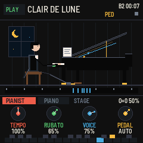
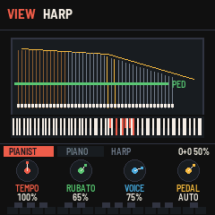
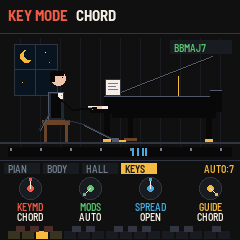

# Clair Piano

**Clair Piano** turns the M-VAVE FM-1 into a calibrated physical-modal concert grand piano with a configurable virtual pianist, **Tap Pianist** interactive score performance, a one-finger **Piano Chord** keyboard, and a 4-slot live song recorder. Every sound is synthesised in real time across both cores of the FM-1's 396 MHz `pi32v2` processor — zero samples, zero ROM wavetables.

  

- **Install on The Firmware Hub** or directly via Web MIDI (Chrome / Edge): <https://tokumine.github.io/fm1-claire-piano/install/>
- **Try it in your browser** (WebAssembly emulator, no FM-1 required): <https://tokumine.github.io/fm1-claire-piano/emu/>
- **Read the manual**: <https://tokumine.github.io/fm1-claire-piano/manual/> (source: [app/docs/MANUAL.md](app/docs/MANUAL.md))
- **Download signed release packages**: [GitHub Releases](https://github.com/tokumine/fm1-claire-piano/releases)

> **Hardware notes:** Supports both FM-1 flash revisions (`0x856014` and newer `0xB36014` `UC25HQ80`). Runs PLL1 at `cpu_clock = 396` MHz with `cpu2_fallback = true` so all 14 polyphonic voices (224 stiff-string partials + 28 longitudinal phantom partials + 16-mode bridge resonator + sympathetic strings + 4-line Hadamard FDN hall) render at ~60% CPU with zero xruns. Plug in headphones or USB audio for full stereo harp width and sub-bass!
>
> **Storage compatibility:** Clair Piano keeps its settings and 4 user song slots in its own flash layout and does not read projects or samples created by other firmwares (back up other firmwares' work before switching). Leaving Clair Piano back to stock V15 or any other custom firmware works normally via Web MIDI or M-Flasher.

## Highlights

- **Dual-Core Physical-Modal Grand Piano Engine (`app/dsp_piano.c`):**
  - **16 stiff-string Magic-Circle partials per voice** ($f_n = n f_1 \sqrt{(1 + B n^2)/(1 + B)}$) calibrated to measured Yamaha C5 harmonic fine structure, plus **longitudinal sum-frequency phantom partials** in the bass/tenor and register-scaled **upper dispersion wavelets** (partials 17–44).
  - **3-string unison beating & 3-stage decay:** prompt decay ($r_1$), bridge-coupled third string ($1.2\sqrt{r_1 r_2}$), long aftersound ($r_2$), slow phase wander, and hard-strike pitch settling.
  - **Soundboard, Bridge & Damper Physics:** compile-time eigenfunction soundboard transfer function paired with a live **16-mode spatial bridge resonator**, **5-band NoisePool** (90–1440 Hz hammer felt thud, damper landing whump, and pedal-lift string sigh), 4-class frequency-dependent damper release, sympathetic open-string combs, and a 4-line Hadamard FDN concert hall.
- **Three Ways to Play the 27 Keys:**
  - **PIANO (default):** Pure velocity- and pressure-sensitive 27-key concert grand piano (`OCT-` / `OCT+` across all 88 keys; `FX` sustain pedal — tap < 350 ms to toggle lock, or hold like a real pedal).
  - **TAP PIANIST (`ARP` button):** Tap *any* key to step chord-by-chord through any of the 87 built-in classical pieces (or your recorded user songs) with **your own timing and finger velocity**.
  - **CHORD (`LFO` button → `K1`):** Keys `F3–B3` act as smart lockable/momentary harmony modifiers (`5`, `sus2`, `6`, `sus4`, `7`, `dim`, `9`) while keys `C4–B5` voice concert piano chords (`CLOSE`, `OPEN`, or `ROLL` arpeggio).
- **87 Public-Domain Masterworks + 4 User Recording Slots:**
  - Built-in LZ4-compressed library including Debussy (*Clair de lune*, *Première Arabesque*), Satie (*Gymnopédies* 1 & 2), Chopin (*Nocturne*, *Fantaisie-Impromptu*, *Raindrop* & Op. 28 Preludes, *Revolutionary Etude*, *Minute Waltz*), Beethoven (*Pathétique*, *Appassionata*, *Sonata Op. 109*, *Für Elise*), Bach, Mozart, Schumann, Schubert, Brahms, Grieg, and Joplin rags.
  - Shape the virtual pianist live on the `HOME` deck (`TEMPO`, `RUBATO`, `VOICING`, `PEDAL`).

## Quick Controls

| Control | Function |
|---|---|
| **Keys (27)** | Pure Grand Piano notes (or Tap Pianist / Chord Mode when selected) |
| **HOME · SEL · ENV · LFO** | Decks: **PIANIST** (`HOME`), **BODY** (`SEL`), **HALL** (`ENV`), **KEYS** (`LFO`) |
| **EDIT** | Cycle pixel-art views: **STAGE** (moonlit concert grand), **HARP** (88 strings + dampers), **TAPE** (dual-reel recorder) |
| **ARP** | Toggle **Tap Pianist** (`TAP` ↔ `PIANO`; hold 0.45s to toggle Sustain) |
| **FX** | Sustain damper pedal (quick tap toggles lock; hold acts as momentary sustain) |
| **PRESET** / **ALGO** / **SELECT** | Browse piece / browse composer category / scrub bar backward & forward |
| **PLAY · SEQ · REC · SAVE** | Play/pause pianist · stop & panic · record into User Slot 1–4 · save settings & user songs |
| **GLO** | Bluetooth MIDI & theme setup (hold `SAVE` on Setup to pair/scan BLE MIDI controllers) |

## Building and Testing

Clair Piano is built on [fm1-base](https://github.com/charlesvestal/fm1-base) (`base/`, a git submodule). Clone with `--recursive`:

```sh
git clone --recursive https://github.com/tokumine/fm1-claire-piano.git
cd fm1-claire-piano
./build.sh                                                  # app/build/clair_piano.fwsc
sh tests/run_tests.sh                                       # OTA check, update loader, host simulator scenario
./build.sh --web                                            # browser WebAssembly emulator in app/build/emu/
python3 base/tools/fm1_install.py app/build/clair_piano.fwsc
```

Releases are built and signed with Sigstore build provenance on GitHub Actions via [`zvenson/fm1-build@v1`](https://github.com/zvenson/fm1-build).

## Credits & Licence

Free software under **Mozilla Public License 2.0** (`MPL-2.0`); see [LICENSE](LICENSE) and [LICENSING.md](LICENSING.md). Built on [fm1-base](https://github.com/charlesvestal/fm1-base) by Charles Vestal and [felucca-bsp](https://github.com/hugelton/felucca-bsp) from [Felucca](https://github.com/hugelton/Felucca) by Leo Kuroshita (Hügelton Instruments). Built-in classical scores are public-domain editions from the [Mutopia Project](https://www.mutopiaproject.org) and Craig Stuart Sapp's Humdrum encodings of 1915 public-domain editions. M-VAVE and FM-1 are trademarks of their respective owners; Clair Piano is independent firmware and not affiliated with M-VAVE.
