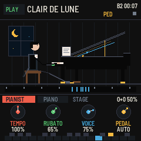
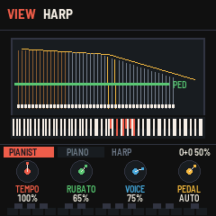
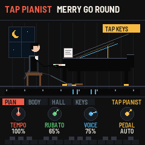
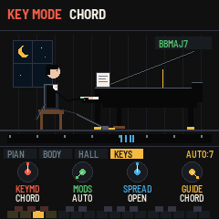

# Clair Piano Manual

Clair Piano is a physical-modal concert grand piano firmware for the M-VAVE FM-1. Every voice renders 16 stiff-string partials with measured Yamaha C5 harmonic fine structure, 3-string unison beating, longitudinal bass phantom partials, upper-register dispersion wavelets, a 16-mode spatial bridge resonator, 5-band hammer/damper felt noise, sympathetic open strings, and a 4-line Hadamard FDN concert hall across both CPU cores at 396 MHz.

  

## 1. Playing the Grand Piano

- **27 Silicone Keys:** Velocity- and pressure-calibrated concert grand piano (`OCT-` / `OCT+` shifts across all 88 piano keys A0–C8).
- **Sustain Pedal (`FX` button):**
  - **Quick tap (< 350 ms):** Locks or unlocks sustain (`PED` indicator in the top bar).
  - **Press & hold:** Acts like a real damper pedal — releases cleanly with audible damper-felt landing and string sigh when lifted.
- **Headphones vs. Speaker:** Plugging into the headphone jack (or capturing over USB Audio) automatically switches from speaker voicing to full-range 3D stereo harp panning and deep sub-bass.

## 2. Three Keyboard Modes (`ARP` & `LFO` Deck)

 

1. **PIANO (Default):** Pure 27-key chromatic concert grand piano.
2. **TAP PIANIST (Press `ARP`):** Perform any of the 87 built-in pieces (or your 4 user recordings) yourself! Every tap on *any* key advances to the next chord or melody note in the score using **your exact timing and finger strike velocity**, while automatic harmonic pedalling breathes underneath. Press `ARP` again to return to pure `PIANO` mode.
3. **CHORD (Press `LFO`, turn `K1` to `CHORD`, or press `LFO` twice):**
   - **Left 7 keys (`F3..B3`):** Harmony modifiers — `5` (F3), `sus2` (F#3), `6` (G3), `sus4` (G#3), `7` (A3), `dim` (A#3), `9` (B3). In `AUTO` mode (`K2`), a quick tap toggles lock (press `LFO` to clear locks) and holding a modifier while playing a chord applies it momentarily.
   - **Upper 20 keys (`C4..G5`):** Voiced concert grand piano chords (`CLOSE`, `OPEN` concert voicing, or `ROLL` pianist arpeggio via `K3`).

## 3. The Four Control Decks

| Button | Deck | Knob 1 (`K1`) | Knob 2 (`K2`) | Knob 3 (`K3`) | Knob 4 (`K4`) |
|---|---|---|---|---|---|
| **`HOME`** | **PIANIST** | `TEMPO` (40–180%) | `RUBATO` (0–100%) | `VOICE` (melody voicing) | `PEDAL` (`DRY`, `HALF`, `AUTO`, `LUSH`) |
| **`SEL`** | **BODY** | `LID` (`CLOSED`..`CONCERT`) | `STRING` (`PURE`..`ANTIQUE`) | `ACTION` (`VELVET`..`BRIGHT`) | `FELT` (soft una-corda felt) |
| **`ENV`** | **HALL** | `ROOM` (`PARLOR`..`CATHEDRAL`) | `SEAT` (`BENCH`..`BALCONY`) | `BODY` (wood resonance) | `TILT` (warm–airy balance) |
| **`LFO`** | **KEYS** | `MODE` (`PIANO`, `CHORD`, `TAP`) | `MODS` (`AUTO`, `LOCK`, `HOLD`) | `SPREAD` (`CLOSE`, `OPEN`, `ROLL`) | `GUIDE` (LED key guide) |

## 4. Built-In Repertoire & 4-Slot Recorder

- **Browse Pieces (`PRESET` encoder):** Step through 87 public-domain works (Debussy, Satie, Chopin, Beethoven, Bach, Mozart, Schubert, Schumann, Brahms, Grieg, Joplin) plus 4 User Slots (`USER SONG 1..4`).
- **Browse Categories (`ALGO` encoder):** Filter by `ALL`, `DEBUSSY/SATIE`, `CHOPIN`, `BEETHOVEN`, `BAROQUE`, `CLASSICAL`, `ROMANTIC`, `RAGTIME/WALTZ`, or `USER SLOTS`.
- **Scrub Bars (`SELECT` encoder):** Jump backward or forward bar-by-bar during playback or Tap Pianist performance.
- **Play / Stop (`PLAY` / `SEQ`):** Start or pause the virtual pianist (`PLAY`); stop immediately and silence strings (`SEQ`).
- **Record (`REC`) & Save (`SAVE`):** Press `REC` to arm a User Slot (recording starts on your first key strike, capturing exact note timing, velocity, duration, and sustain pedal). Press `REC` or `SEQ` to finish, and press `SAVE` to persist settings and user songs to flash.

## 5. Views, MIDI & Bluetooth

- **Pixel-Art Views (`EDIT`):** Cycle between **STAGE** (animated moonlit concert pianist), **HARP** (88 real-time string energy bars + damper rail), and **TAPE** (dual-reel transport + polyphony meter).
- **USB, TRS & Bluetooth MIDI (`GLO`):** Full MIDI input (notes, velocity, CC64 sustain, CC67 soft pedal) over USB MIDI, TRS MIDI, and Bluetooth LE MIDI (both peripheral and central host pairing on the `GLO` Setup screen; hold `SAVE` on Setup to scan/pair a nearby BLE MIDI keyboard, or turn `K4` to toggle BLE at boot).
