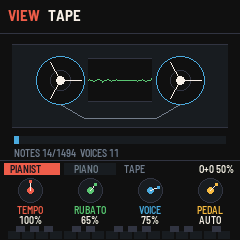

# Pianola Manual

**Pianola** is a modern tap-played player grand piano for the M-VAVE FM-1. It pairs an 87-roll classical library (plus 4 recordable user rolls) with a dual-core 396 MHz physical-modal concert grand engine: 16 stiff-string partials per voice, 3-string unison beating, longitudinal bass phantom partials, a 16-mode spatial bridge resonator, 5-band hammer/damper felt noise, sympathetic open strings, a 4-line Hadamard FDN concert hall, and a transparent stereo peak-hold limiter.

  

## 1. Tap-Playing the Pianola (Default ON, When Stopped)

When Pianola powers on, **Pianola mode is immediately active** (amber `TAP` + `PIANOLA` badge on screen, `ARP` LED lit):

- **Tap any of the 27 keys** to step chord-by-chord through the loaded piano roll (*Clair de lune* is loaded first).
- **Your timing = the phrasing:** linger on a climax, rush an arpeggio, breathe between bars — every strike fires on your exact finger landing.
- **Your touch = the dynamics:** the FM-1's velocity-calibrated silicone keys scale every chord from hushed *pianissimo* to concert *fortissimo* while preserving the score's melody-over-accompaniment voicing (`VOICE` knob).
- **Hold & Release:** hold a key to let its notes ring; release to lift dampers (while automatic harmonic pedalling sustains across chord tones according to `PEDAL`).

## 2. Live Punch-In FX & Pianist Flourishes (During `PLAY`)

Press **`PLAY`** to start the roll hands-free. While playing in Pianola mode, the top-right badge switches to cyan **`LIVE FX`** and the 27 keys become a **Pocket-Operator-style live performance keyboard** — hold any key (or combine several!) to reshape the performance, and release to drop cleanly right back into the score at the exact splice point:

### Left 12 Keys (`F3..E4`) — PO-Style Time, Loop & Dynamics FX
| Key | Effect | Behavior |
|---|---|---|
| `F3` (`k0`) | **`HALF 0.5X`** | Half-time slowdown |
| `F#3` (`k1`) | **`BRAKE`** | Mechanical/tape rubato slowdown while held |
| `G3` (`k2`) | **`FAST 1.5X`** | Expressive 1.5× forward rush |
| `G#3` (`k3`) | **`FREEZE`** | Sustains damper pedal & pauses score at splice point; releases cleanly |
| `A3` / `A#3` / `B3` (`k4..k6`) | **`RPT 1/2` · `1/4` · `1/8`** | Beat-synced roll repeat loops around the splice point; snaps cleanly back on release |
| `C4` (`k7`) | **`STACCATO`** | Lifts damper pedal & shortens notes to crisp ~72 ms staccato |
| `C#4` (`k8`) | **`UNA FELT`** | Instant soft una-corda felt hush |
| `D4` (`k9`) | **`SWELL FF`** | Engages damper pedal & boosts concert fortissimo swell |
| `D#4` / `E4` (`k10..k11`) | **`OCT -1` / `OCT +1`** | Deepens bass an octave / lifts melody an octave |

### Right 15 Keys (`F4..G5`) — In-Key & Tempo-Synced Pianist Flourishes
Every flourish locks to the roll's live detected chord & scale and scales its timing to `TEMPO`:
- `F4` **`BASS OCT`** · `F#4` **`PEDAL 5TH`** · `G4` **`ARP UP`** · `G#4` **`ARP DN`** · `A4` **`HARP RUN`** · `A#4` **`ROLL CHD`**
- `B4` **`TRILL`** *(sustains while held)* · `C5` **`TURN`** · `C#5` **`MORDENT`** · `D5` **`TREMOLO`** *(sustains while held)*
- `D#5` **`SHIMMER`** · `E5` **`GRACE 9`** · `F5` **`OCT MEL`** · `F#5` **`CADENZA`** · `G5` **`GLISS`**

## 3. Breaking Out to Basic Piano & Chord Mode

- **Basic Piano (`ARP` button):** Tap `ARP` once to turn Pianola tap-play off and play a pure, velocity- and pressure-sensitive **27-key Concert Grand Piano** (`OCT-` / `OCT+` spans all 88 piano keys A0–C8). Tap `ARP` again to jump straight back to **Pianola** mode.
- **Sustain Pedal (Hold `ARP` 0.45s or MIDI CC64):** Latch/release the damper pedal with audible felt landing whump and open-string sigh.
- **One-Finger Chord Mode (`LFO` button):** Press `LFO` to open the `KEYS` deck (press `LFO` again to toggle **Chord Mode** ↔ **Pianola**):
  - **Left 7 keys (`F3..B3`):** Harmony modifiers — `5` (F3), `sus2` (F#3), `6` (G3), `sus4` (G#3), `7` (A3), `dim` (A#3), `9` (B3). In `AUTO` mode (`K2`), a quick tap locks/unlocks (hold `LFO` 0.7s to clear all locks) and holding a modifier while pressing a chord applies it momentarily.
  - **Upper 20 keys (`C4..G5`):** Voiced concert grand chords (`CLOSE`, `OPEN` wide voicing, or `ROLL` pianist arpeggio via `K3`).
- **Headphones & USB Audio:** Plugging in headphones (or recording over USB Audio) automatically switches from speaker voicing to full-range 3D stereo harp width and deep sub-bass.

## 3. Choosing Rolls & Recording Your Own

- **Browse Rolls (`PRESET` encoder):** Step through 87 public-domain piano rolls (Debussy, Satie, Chopin, Beethoven, Bach, Mozart, Schubert, Schumann, Brahms, Grieg, Joplin) plus 4 User Slots (`USER SONG 1..4`).
- **Composer Shelves (`ALGO` encoder):** Filter by `ALL`, `DEBUSSY/SATIE`, `CHOPIN`, `BEETHOVEN`, `BAROQUE`, `CLASSICAL`, `ROMANTIC`, `RAGTIME/WALTZ`, or `USER SLOTS`.
- **Scrub Bars (`SELECT` encoder):** Jump backward or forward bar-by-bar at any time.
- **Rewind (`SEQ`):** Stop auto-play, rewind the current roll to bar 1, and silence ringing strings.
- **Record a Custom Roll (`REC` + `SAVE`):** Press `REC` to arm a User Slot (switch to Basic Piano or Chord Mode or play an external MIDI keyboard — recording starts on your first note). Press `REC` or `SEQ` to finish, then press `SAVE` to store your roll in flash. You can then tap-play your own recording in Pianola mode! (Hold `EDIT` 1s on a User Slot to clear it.)

## 4. The Four Control Decks

| Button | Deck | Knob 1 (`K1`) | Knob 2 (`K2`) | Knob 3 (`K3`) | Knob 4 (`K4`) |
|---|---|---|---|---|---|
| **`HOME` / `FX`** | **ROLL** | `TEMPO` (50–150%) | `RUBATO` (0–100%) | `VOICE` (melody voicing) | `PEDAL` (`DRY`, `HALF`, `AUTO`, `LUSH`) |
| **`SEL`** | **BODY** | `LID` (`CLOSE`..`CONCT`) | `BODY` (`UPRGT`..`CONCT`) | `STRING` (`PURE`..`FELT`) | `ACTION` (`LIGHT`..`NOISY`) |
| **`ENV`** | **HALL** | `ROOM` (`PARLR`..`CATHD`) | `SEAT` (`BENCH`..`BACK`) | `SOFT` (`AUTO` / `UNA`) | `GUIDE` (`OFF`, `SCALE`, `CHORD`) |
| **`LFO`** | **KEYS** | `KEYMD` (`PIANO`, `CHORD`, `PIANOLA`) | `MODS` (`AUTO`, `LOCK`, `HOLD`) | `SPREAD` (`CLOSE`, `OPEN`, `ROLL`) | `GUIDE` (`OFF`, `SCALE`, `CHORD`) |

## 5. Views, Themes & MIDI / Bluetooth

- **Pixel-Art Views (`EDIT`):** Cycle **STAGE** (animated moonlit concert grand), **HARP** (88 live strings + damper rail), and **TAPE** (dual-reel roll transport + polyphony meter).
- **Theme & Bluetooth (`GLO`):** Tap `GLO` to switch between **OP-Dark** and **OP-Paper** themes. Hold `GLO` 1s to toggle Bluetooth MIDI on/off; hold `REC` 1s to scan/pair a nearby BLE MIDI keyboard (select with `ALGO`, hold `REC` to connect).
- **External MIDI:** Full USB MIDI, TRS MIDI, and BLE MIDI input (notes, velocity, CC64 sustain) always plays the grand piano directly.
